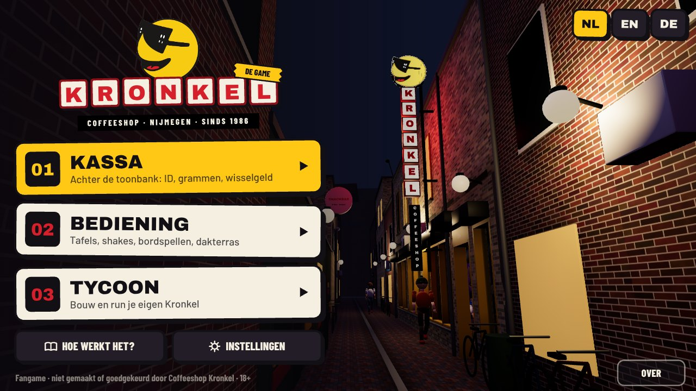
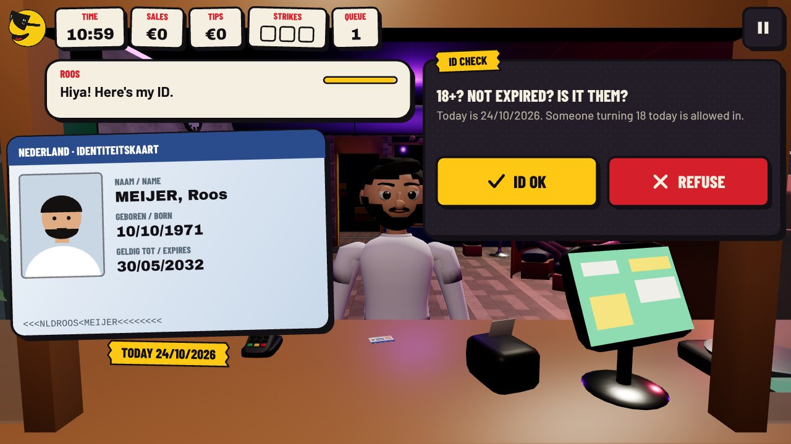
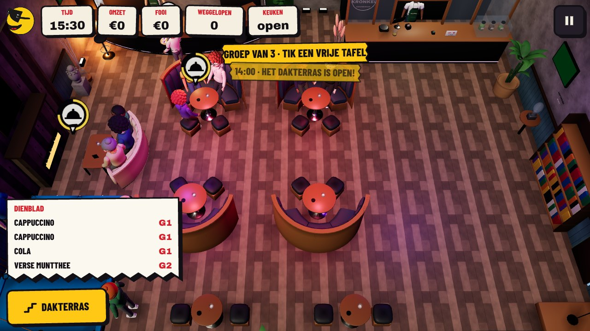
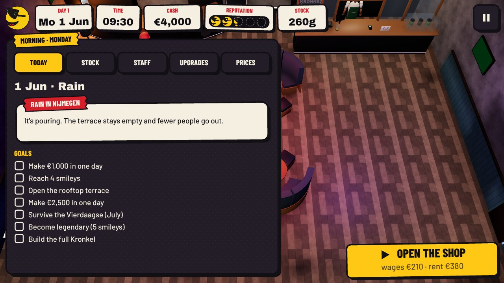
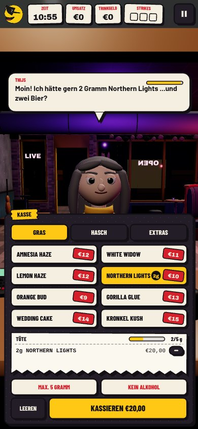
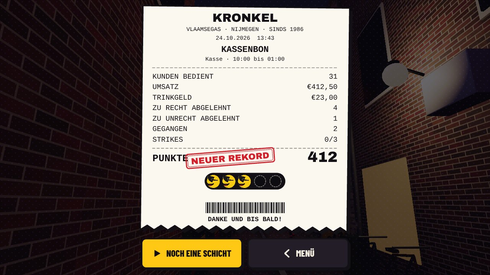
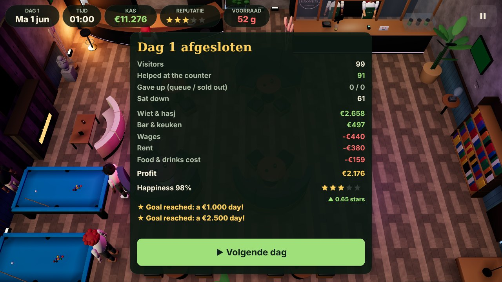
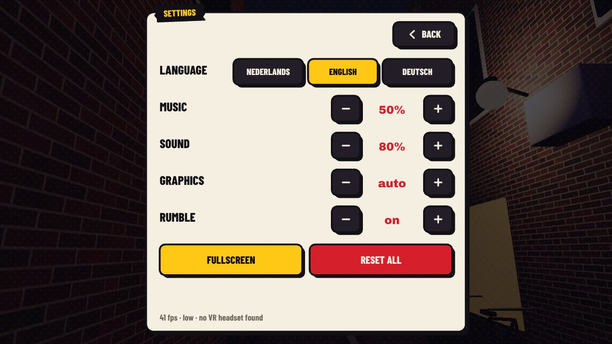
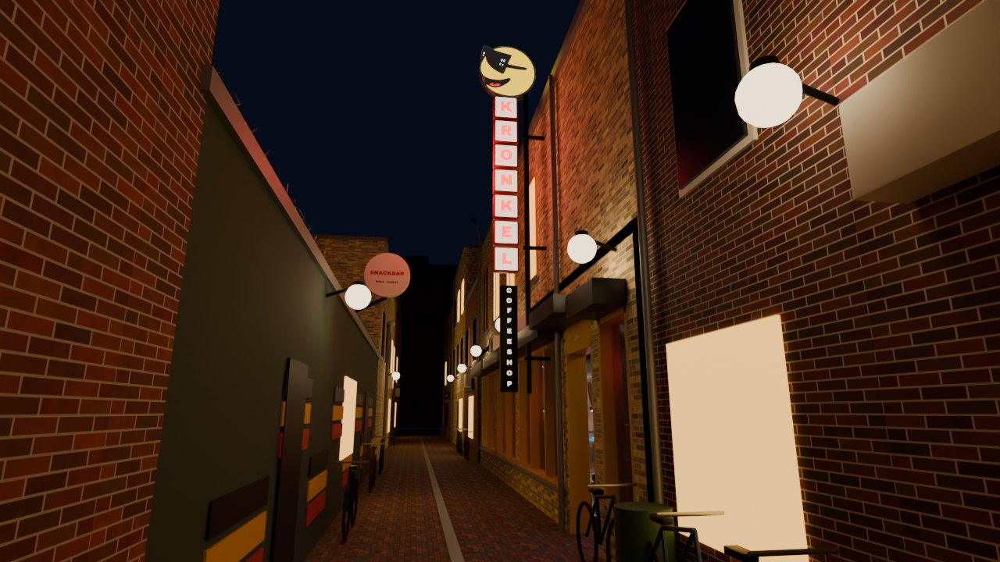
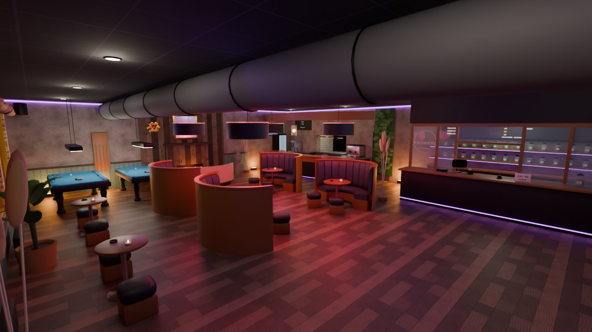

# Kronkel: The Coffeeshop Game

A fan-made game set in **Coffeeshop Kronkel** on Vlaamsegas in Nijmegen (since 1986). It's not an ad, just a game
centred on the place: work the counter, run the floor, or build and manage your own Kronkel.

It runs in the browser on **desktop, phones and tablets** (installable to the home screen and playable offline),
with **game controllers**, and in **VR headsets** through WebXR (Quest, Pico, Vision Pro and other WebXR browsers).
All 3D models are built in **Blender**. It plays in **Nederlands, English and Deutsch**: the language follows your
browser, and the NL / EN / DE stickers on the title screen (or *Settings*) switch it at any time.



| Kassa | Bediening | Tycoon |
| --- | --- | --- |
|  |  |  |

| Phone (Deutsch) | Shift receipt | Day report |
| --- | --- | --- |
|  |  |  |

| Settings and languages | The alley (Blender render) | Inside (Blender render) |
| --- | --- | --- |
|  |  |  |

## The look

The UI is built from Kronkel's own street identity instead of a generic game skin:

- **The smiley with sunglasses** is the mascot: it bobs in the HUD, hops when you do well and shakes when you mess up,
  and it's the rating (smileys, not stars).
- **The alley sign**: headings are red letters on white tiles with a dark red frame, like the tall KRONKEL blade sign,
  with the black COFFEESHOP strip under it.
- **Paper things from a shop counter**: stickers with thick ink outlines and hard shadows, tape labels, comic balloons
  for what customers say, rubber stamps (GOEDGEKEURD / GEWEIGERD), and shifts and days that end on a printed receipt.
- **Colours** come from the logo and the interior: smiley yellow, ink black, sign red, paper cream, with the purple
  LED glow of the shop behind it. Type is Archivo Black for the big words and Barlow / Barlow Condensed for the rest.

## Game modes

| Mode (NL / EN / DE) | You are | What you do |
| --- | --- | --- |
| **Kassa** / Counter / Kasse | The cashier behind the glass | Check IDs (18+, not expired, photo matches, birthday today counts), take orders, enforce the 5 gram rule, refuse alcohol, ring it up, take PIN or count out change. Three Handhaving strikes and the shop gets closed. |
| **Bediening** / Service / Bedienung | The floor staff | Seat groups from the door, take orders, run shakes and food from the pass (kitchen open 12:00 to 22:00), bring board games from the shelf, settle the bill, clean up, take the stairs to the rooftop terrace. Bubbles with a mood ring show who needs you. |
| **Tycoon** | The owner | Each morning buy stock (never more than 500 g, as the law says), hire staff, set prices and ID policy, buy upgrades (pool tables, fireplace lounge, milkshake bar, live music corner, premium shelf, house strain, rooftop terrace...). Watch the day play out, read the report. Weekends, rain, NEC home games, Handhaving inspections and the Vierdaagse in July all matter. |

The Dutch coffeeshop rules (18+ with ID, max 5 gram per person, no alcohol, max 500 gram in stock) are the game
mechanics. Products, prices and characters are made up.

## Play it

Any static web server works; there's no build step.

```bash
npm install          # only needed for the dev server and model compression
npm start            # http://localhost:8080
```

or `python3 -m http.server 8080` in the repo root.

### Controls

- **Touch / mouse**: tap buttons and things in the shop. Drag to pan in Bediening/Tycoon, scroll or pinch to zoom.
- **Keyboard**: arrows/WASD move between buttons, Enter/Space press, Esc back/pause, Q/E switch tabs, F fullscreen.
- **Controller** (Xbox, PlayStation, Switch, generic): stick/d-pad moves focus (also over tables and the pass in
  Bediening), Ⓐ press, Ⓑ back, Ⓧ/Ⓨ quick actions, bumpers switch tabs, triggers zoom, Start pauses. Rumble on mistakes.
- **VR**: press *Play in VR*. Point at the floating panel and pull the trigger; point at tables, the pass or the
  game shelf to send the waiter. Thumbstick snap-turns, B goes back. You stand behind the counter in Kassa mode and
  on the floor in Bediening.
- **Phone**: Share → *Add to Home Screen* to play fullscreen and offline.

### Put it online (GitHub Pages)

`.github/workflows/pages.yml` runs the tests and publishes the game on every push to `main`. Enable it once in the
repository settings: **Settings → Pages → Source: GitHub Actions**. WebXR and the service worker need HTTPS,
which Pages provides.

## How it's built

```
index.html            entry point (import map for three.js, boot screen)
src/main.js           game loop, screen manager
src/i18n.js           translations: t('key'), language detection; dictionaries in src/lang/{nl,en,de}.js
src/world.js          three.js: loads the Blender models, lighting, cameras, people, props, bubbles, picking
src/gui.js            canvas GUI used on screen and on the VR panel (focus navigation for keyboard/gamepad)
src/input.js          touch, mouse, keyboard, gamepad
src/xr.js             WebXR session, controllers, floating panel
src/audio.js          synthesised sound effects and lo-fi music (no audio files)
src/sim/              pure game logic: cashier.js, server.js, tycoon.js, crowd.js, nav.js (A* pathfinding)
src/screens/          title, menus, cashier, server, tycoon, results
assets/layout.json    shop layout shared by Blender and the game (tables, seats, counter, queue...)
assets/gamedata.json  menu, rules, upgrades, staff, events
assets/models/        compressed .glb files exported from Blender
blender/              Blender build scripts + editable .blend files in blender/out/
tests/                node --test suites that play every mode with a bot and check the translations
```

### 3D models (Blender)

Everything 3D (the shop, the alley, the rooftop terrace, the rigged and animated characters, the food and products)
is built in Blender by the scripts in `blender/`, so the models can be rebuilt and tweaked. The editable files are in
`blender/out/*.blend`. Open them in Blender to edit by hand, or change the scripts and rebuild:

```bash
pip install bpy==5.2.3           # Blender as a Python module (or use the Blender app, see below)
npm install                      # gltf-transform, for meshopt compression
python blender/build_all.py      # builds, bakes ambient occlusion, exports, compresses into assets/models/
python blender/build_all.py --previews --only shop   # also render Cycles previews into docs/screenshots/
# with the Blender app instead:  blender -b -P blender/build_all.py -- --previews
```

The shop is modelled after photos of the real place: the narrow alley with the tall red-and-white KRONKEL sign and
the sunglasses smiley on top, the black tile ceiling with the big fabric duct and purple LED glow, pink drum lamps
over high-back leather booths, blue pool tables, the reclaimed-wood fireplace lounge, the curved bar and the
glass-fronted sales counter.

How the models are made:

- **People** (`blender/people.py`) are lofted from cross-section rings, so every body is one smooth shape with real
  clothing layers: crew collars, sleeve hems, pants cuffs, sneakers with soles and laces, mitten hands with thumbs.
  Faces have eye whites, irises with a highlight, relaxed eyelids, eyebrows, a nose and a smile. One rig is shared by
  everyone; the game recolours skin, clothes, hair, hats and shoes and switches between 8 hairstyles (short, long,
  bun, ponytail, curly, buzz, beanie, cap), 4 tops (tee, long sleeve, hoodie, jacket), glasses, beards and the staff
  apron.
- **Props** (`blender/props.py`) are mostly turned on a lathe: glasses have real walls and rims, plates have a foot
  and a well, cream is swirled. Dutch details: verse muntthee with a mint sprig, a speculaas with the coffee,
  appeltaart with a lattice top, fries with a wooden vorkje.
- **Furniture** (`blender/shop.py`) uses soft-furnishing helpers: channel-tufted booth and sofa backs, stuffed seat
  cushions, leather poufs with a button, turned table pedestals, a tablet till and a card terminal on the counter,
  apothecary jars with labels on the back shelves.

### Tests

```bash
npm test
```

The suites check pathfinding, the rules (ID checks, 5 gram trimming, change), and let bots play full Kassa,
Bediening and Tycoon runs (60 in-game days, including the 2026 Vierdaagse on 21–24 July). They also check that
Dutch, English and German have exactly the same keys and placeholders.

### Adding a language

Copy `src/lang/en.js` to a new file, translate the values (keep the `{placeholders}` and the length of the lists),
add it to `DICT` and `LANGS` in `src/i18n.js`, and run `npm test`.

## Please read

- **Fan project.** Not made, endorsed or checked by Coffeeshop Kronkel. The name, sign and smiley logo belong to
  the shop: get their permission before publishing this publicly.
- **18+.** The game opens with an age check. Cannabis is only tolerated for adults in the Netherlands under strict
  rules; this game doesn't encourage anything outside those rules.

## Credits

- 3D models: Blender (scripts in `blender/`), engine: [three.js](https://threejs.org) (MIT, `vendor/three/LICENSE`)
- Fonts: Archivo Black and Barlow (SIL OFL, `assets/fonts/LICENSE-ArchivoBlack.txt`, `assets/fonts/LICENSE-Barlow.txt`)
- Music and sound effects are synthesised in the browser.
